# [Modulation Identification] DFCT-net: A New Breakthrough in Automated Modulation Identification for Drone Communication Systems [Dataset]

Personal Blog: https://www.cnblogs.com/EWFrontier  
DFCT-net: A New Breakthrough in Autonomous Modulation Identification for Drone Communication Systems  
Topic: The Double-Stream Convolutional Transformer Network (DFCT-net) for Autonomous Modulation Identification in Drone Communication Systems  
Abstract: With the continuous expansion of the frequency range of broadband communication signals and the increasingly complex electromagnetic environment, the detection and recognition of low signal-to-noise ratio (SNR) signals pose greater challenges to existing technologies. This paper proposes a double-stream convolutional transformer network (DFCT-net) for automatic modulation identification in drone communication systems. This network extracts and fuses features from both time and frequency domains. Firstly, a convolutional LSTM and channel enhancement network (CLCE-Net) are designed to adaptively enhance and extract spatiotemporal features from the time domain; secondly, a convolutional neural network is combined with the Transformer to achieve efficient recognition of low SNR signals in the frequency domain, and an unsupervised convolutional autoencoder is used to denoise the signal spectrum. Experiments on the RadioMod-5.8G-160K and HisarMod2019.1 datasets show that DFCT-net achieves current state-of-the-art performance while improving parameter efficiency, highlighting its potential application in real-world drone communication systems.  
Introduction: In modern military operations, drones (UAVs) play increasingly important roles in tasks such as reconnaissance surveillance, target recognition, precise strike, and battlefield command and communication. Automated modulation identification (AMR) is a key link between signal detection and communication decryption, capable of classifying signals based on their characteristics, providing support for signal analysis, and holding significant importance in wireless communication, electronic reconnaissance, and military communications.
In drone communication, AMR faces unique challenges: firstly, dynamic channels significantly impact maneuverability, causing Doppler shifts and time-varying fading due to high-speed motion, and three-dimensional trajectories leading to abrupt path loss changes, making traditional static models difficult to adapt; secondly, Frequency Hopping Spread Spectrum (FHSS) technology is widely used for control signals, combining phase-shift keying (PSK), quadrature amplitude modulation (QAM) with other modulation methods. However, rapid frequency hopping leads to fragmentation of time-frequency, energy decoupling, and an unknown hopping pattern, rendering traditional algorithms dependent on continuous spectrum characteristics ineffective; thirdly, in non-cooperative scenarios, scarcity of labeled data exacerbates the instability of features due to FHSS's dynamic variation, further increasing recognition difficulty. The role of drones in modern military operations has become increasingly critical, highlighting the necessity of targeted AMR research.
AMR performance highly depends on the quality of received signals. In noisy low SNR scenarios, signal features can be weakened or even masked, directly leading to a significant drop in classification accuracy. In modern communication environments, signal propagation inevitably suffers from multipath effects, obstacles reflecting, refracting, and scattering signals can cause multipath delays, resulting in phase offsets or distortions in the received signal, directly affecting the accuracy of AMR based on phase and constellation diagrams; additionally, in hostile environments, various forms of electronic interference (such as malicious radio jamming, spectrum suppression, etc.) further complicate the signal complexity. Therefore, denoising has become a core step in enhancing AMR system performance. Existing denoising methods include filtering, signal decomposition and reconstruction, and deep learning-based denoising, but these methods rely on assumptions and are computationally complex. This paper adopts unsupervised convolutional autoencoder (DAE) to enhance AMR accuracy by leveraging its strong feature extraction and denoising capabilities through self-learning.
The approaches to AMR mainly fall into two categories: traditional machine learning algorithm-based modulation recognition methods and deep learning methods. Support vector machines, decision trees, and other traditional methods perform poorly under low SNR conditions, struggle with feature selection, and are greatly affected by noise; whereas deep learning, through automatic feature extraction, can better handle nonlinear relationships and noise in complex environments, demonstrating strong adaptability and robustness.
The expansion of modulation recognition datasets has become a key driver in advancing deep learning in the AMR field. Existing public datasets, such as RML2016, RML2018 series, and HisarMod2019.1 dataset, provide foundational data support for related research. Deep learning has been widely applied in fields such as image classification, target detection, and speech recognition, and is gradually penetrating into AMR. Convolutional Neural Networks (CNNs) are adept at automatically learning effective features from raw signals, especially IQ signals, but relying solely on CNNs to mine modulation features has encountered bottlenecks, leading to the emergence of integrated networks as a hot topic of research. In complex electromagnetic environments, analyzing only IQ signals is insufficient. Research trends include converting radar signals into time-frequency images for recognition and utilizing spectral graph classification, but the local sensitivity of CNNs hinders the construction of global features and long-range dependency learning. The application of attention mechanisms in AMR can enhance signal feature representation, but fixed attention mechanisms are difficult to adapt to non-stationary channels and are prone to overfitting, limiting their application in complex scenarios.
In response to the aforementioned issues, this paper designs a dual-stream network structure that integrates CNN and Transformer for low signal-to-noise ratio signal modulation recognition in complex spectrum environments of unmanned aerial vehicle communication systems. This network fuses the time-domain and frequency-domain features of UAV communication system signals to achieve accurate classification and recognition of signals.
The specific contributions of this article are as follows:
1  
To comprehensively capture features, the Convolutional Channel Enhancement Network (CLCE-Net) integrates convolution operations and Long Short-Term Memory networks (LSTM) to learn spatiotemporal features. Additionally, an Efficient Channel Attention (ECA) is introduced to further enhance the network's adaptability in channel dimensions, thereby improving the representation of temporal features.
2  
A novel Convolution-Transformer Fusion Network (TConvF-Net) is proposed, which combines the local features extracted by CNN with the global representation captured by Transformer to achieve comprehensive analysis of frequency domain signals. Additionally, an unsupervised convolutional autoencoder is employed to denoise the frequency domain signals, enhancing the recognition capability of low signal-to-noise ratio signals.
3  
Cross-Domain-Frequency Integration (CTF) module achieves cross-domain feature fusion by integrating time and frequency representations, and significantly enhances performance by outputting model results through a linear classification layer.
This paper constructs the RadioMod-5.8G-160K dataset, comprising 160,000 signal samples from 20 modulation types in the 5.8GHz frequency band, with a signal-to-noise ratio ranging from -18dB to 12dB. This dataset covers drone video transmission signals, expanding the available spectrum resources. Through rigorous ablation experiments and comparative experiments, it comprehensively evaluates the network's performance and generalization capabilities. The quantitative analysis of the average classification accuracy and visualization of classification results all indicate that the proposed framework exhibits excellent performance and effectiveness. Multiple datasets have been experimentally validated, confirming its good performance and robust generalization capabilities.
Method Introduction The Double-Flow Convolutional Transformer Network (DFCT-net) proposed in this paper is suitable for the automatic modulation recognition task of UAV communication systems. It adopts a dual-flow architecture, integrates convolutional neural networks (CNNs) and attention mechanisms, and contains three core modules and dataset construction.
1. Network Overall Architecture DFCT-net
First, the time-domain signal is preprocessed through convolutional LSTM and channel enhancement network (CLCE-Net). This network combines convolutional layers with LSTM to effectively capture and enhance time-domain features. It then enhances the adaptability of channel dimensions through an efficient channel attention (ECA) mechanism; subsequently, unsupervised convolutional autoencoder is used to denoise the frequency-domain signal, enhancing the recognition capability of signals with low signal-to-noise ratio; next, a convolution-Transformer integrated network (TConvF-Net) integrates the local features of CNN with the global features of Transformer to achieve precise analysis of frequency-domain signals; finally, the cross-time-domain-frequency-domain integration (CTF) module integrates both time-domain and frequency-domain features, outputting classification results through a linear layer.
2. Core Module Design
• CLCE-Net (Convolutional LSTM and Channel Enhancement Network): Input IQ time-domain signal data. Through two parallel two-dimensional convolutions, Leaky ReLU activation function, and DropConnect feature extraction blocks, extract features. Each stage introduces an ECA module, which dynamically determines the kernel size through one-dimensional convolution for cross-channel interaction and attention computation, balancing performance and complexity. After element-wise addition and pooling operations to integrate compressed features, input into a bidirectional LSTM (Bi-LSTM) further models temporal dependencies, ultimately outputting time-domain features through fully connected mapping.
TConvF-Net (Convolution-Transformer Fusion Network): Divided into two parts: frequency domain signal denoising and feature extraction. Firstly, the time domain IQ signal is transformed into frequency domain signal through Fast Fourier Transform (FFT). Noise removal is achieved by unsupervised convolutional autoencoder (D-AE), which consists of a one-dimensional convolutional neural network and pooling layers, including an encoder, decoder, and noise addition component. After transforming the IQ signal to the frequency domain through Fourier transformation, Gaussian white noise and other interferences are added, then the encoder extracts features and the decoder reconstructs signals to achieve denoising. Subsequently, a convolutional pre-feature extraction network is used to extract shallow local features from the denoised spectrum data, introducing learnable positional encoding. The input is then separated attention convolutional transformer (SACT) for local-global feature extraction. SACT consists of multiple stacked layers, each containing a convolution-based local-global feature attention network (MCAE) and multi-head convolution feedforward network (FMHC). It is stabilized through LayerNorm and residual connections. MCAE separates self-attention (capturing global features) and group convolution (extracting local features) by splitting QKV vectors respectively, and then fuses the two types of features. FMHC uses multi-head convolution instead of traditional MLP to improve the efficiency of processing local information and capture temporal relationships.
•
CTF module (Cross-Temporal-Frequency Fusion): The time domain features outputted by CLCE-Net are concatenated along the feature dimension with the frequency domain features outputted by TConvF-Net. After reducing overfitting risk through a Dropout layer, the convolutional layer integrates information at different spatiotemporal scales. Then, after another Dropout layer and unfolding operation, it is input into a fully connected layer to learn higher-order features and map them to classification categories, outputting probability distributions for each category.
3. Dataset Construction
Construct the RadioMod-5.8G-160K dataset by generating standard modulation signals such as PSK, QAM, FSK through a signal generator, and simultaneously collect image transmission and control signals from DJI Mavic 3 drones in the 2.4G/5.8G frequency band. These signals are captured and converted into digital signals using a spectrum analyzer, resulting in 160,000 samples (including 18 types of standard modulation signals + 2 types of drone signals), with a signal-to-noise ratio ranging from -18dB to 12dB. The dataset is divided into training sets, validation sets, and test sets at a ratio of 3:1:1. Additionally, the publicly available dataset HisarMod2019.1 is used for validation, which contains 26 types of modulation signals with a signal-to-noise ratio ranging from -20dB to 18dB, including various noise types.
4. Experimental Settings
• Hyperparameters: AdamW optimizer, dynamic learning rate adjustment, early stopping strategy, DropConnect and Dropout rates both set to 0.2, batch size for RadioMod-5.8G-160K dataset is 512, and for HisarMod2019.1 dataset is 1024.
• Experimental platform: Based on the PyTorch architecture, utilizing a NVIDIA A100 GPU and a workstation with 40GB memory for model training, validation, and testing.
Conclusion: To address the challenge of recognizing drone communication signals under low signal-to-noise ratio conditions, this study introduces an autonomous modulation recognition method based on time-frequency domain integration. It employs unsupervised convolutional autoencoders to process frequency domain signal noise, designs a bidirectional network structure that integrates convolutional neural networks and attention mechanisms, achieving the integration and classification of IQ signals and spectral signals in drone communication systems.
Experimental results show that the recognition accuracy of the proposed DFCT-net model on the HisarMod2019.1 public dataset and the RadioMod-5.8G-160K self-built dataset is superior to the second-best model IC-AMCNET by 3.41% and 4.01%, respectively. It exhibits significant classification advantages under low signal-to-noise ratio (SNR) scenarios, such as a 23.06% to 24.69% higher accuracy when SNR=-18dB compared to traditional SVM methods, and still maintaining a 66.17% accuracy at SNR=-20dB, while the performance of traditional methods sharply drops. In terms of training efficiency, the average training time per round for DFCT-net is 61s (RadioMod-5.8G-160K) and 97s (HisarMod2019.1), significantly faster than LSTM, and its robustness in extreme noise environments far exceeds other baseline models.
However, there are two limitations of DFCT-net: firstly, the introduction of dual-stream architecture and attention mechanism leads to higher computational overhead, resulting in longer training times per round than lightweight models like GRU and CLDNN, which may limit its application in resource-constrained scenarios; secondly, the model is trained and evaluated under closed-set settings, lacking the ability to recognize unknown modulation types in open-set environments, making it difficult to adapt to new modulation schemes that may arise in actual drone communication monitoring.
Future work will focus on two directions: 1) Optimizing network structure through model compression techniques (such as knowledge distillation and pruning) to reduce training and inference time while maintaining recognition performance; 2) Introduce an open-set recognition module (such as contrastive learning for anomaly detection) to expand the framework to effectively differentiate between known and unknown modulation types, enhancing its adaptability to dynamic electromagnetic environments.

## Images

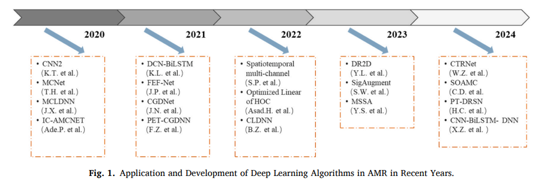
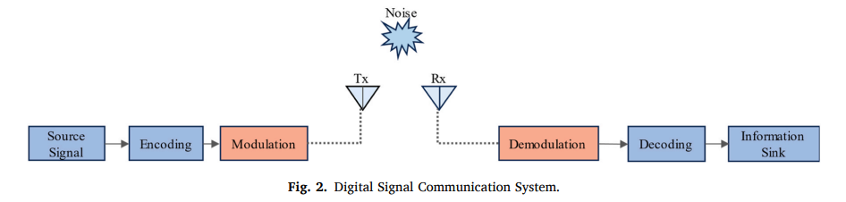
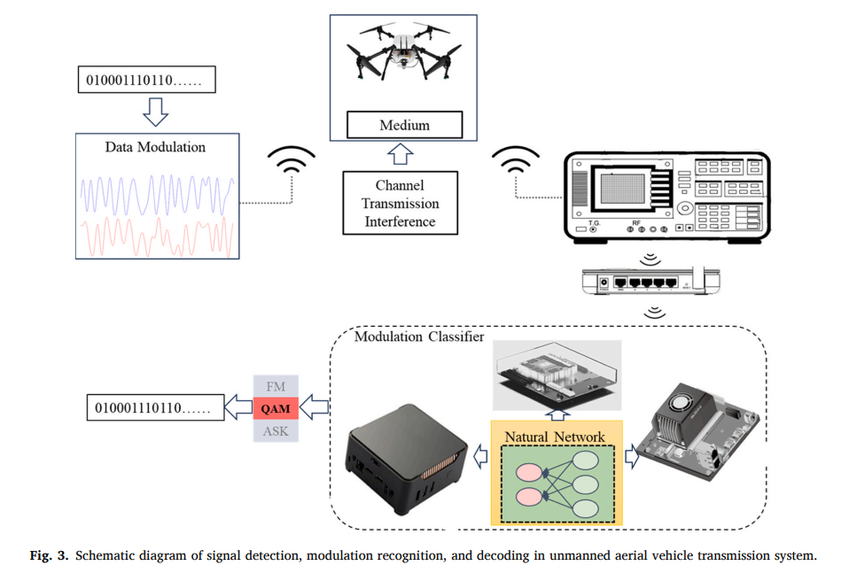
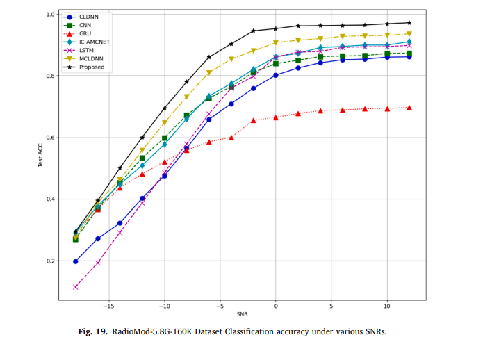
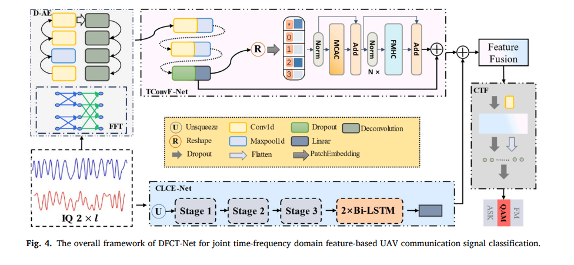
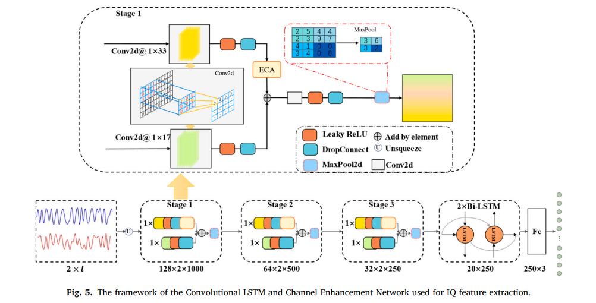
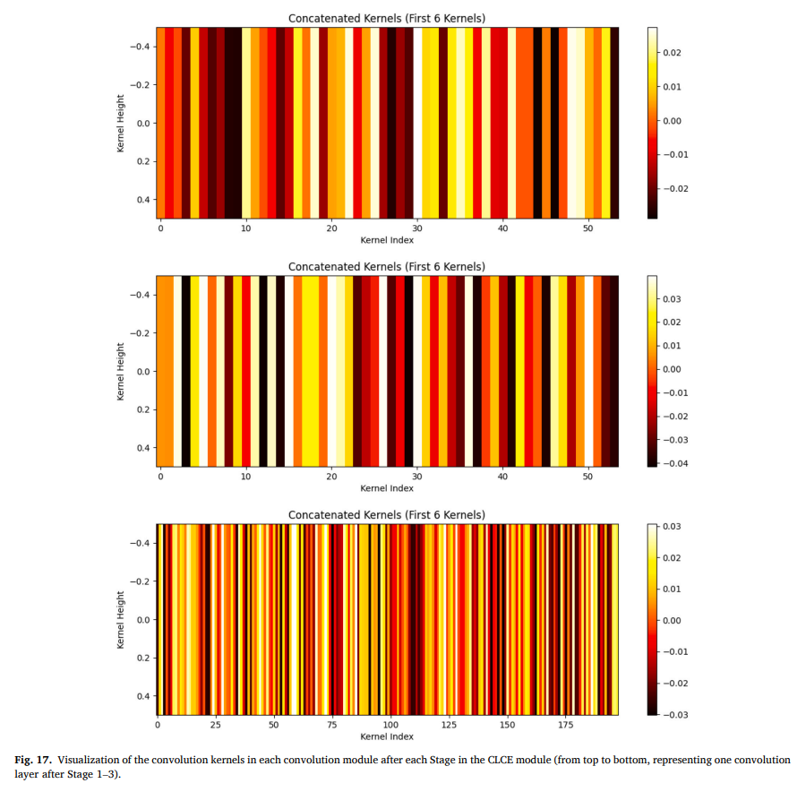
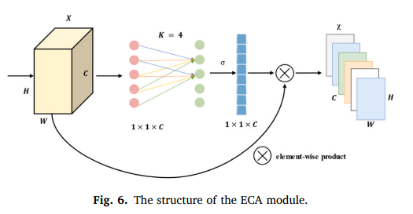
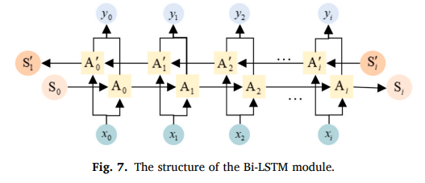
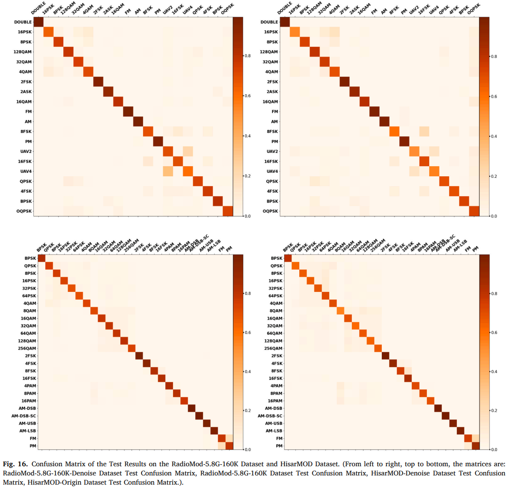
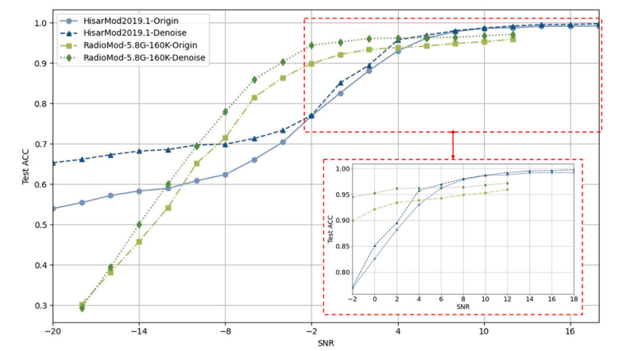
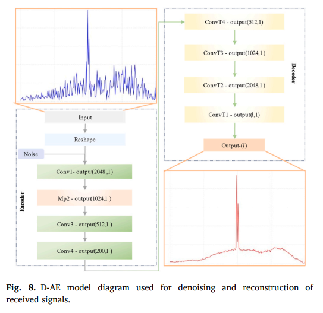
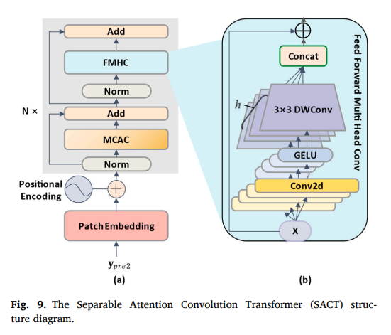
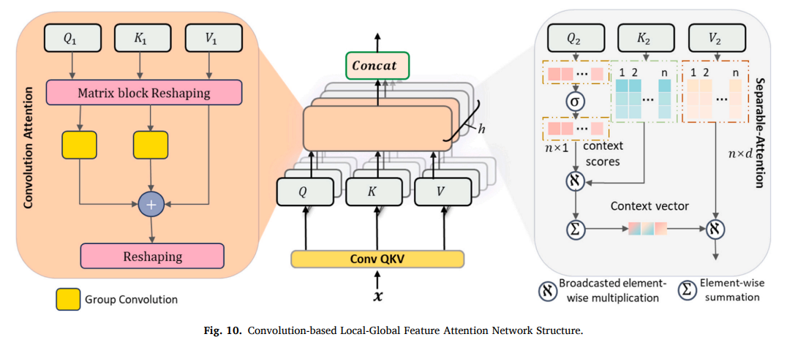

<!-- PAYMENT_BLOCK -->

## Get this dataset

- Payment link (Stripe): [Buy now](https://buy.stripe.com/3cs8yP7sY87d0vu9AB)
- Payment QR code: 

<!-- /PAYMENT_BLOCK -->
